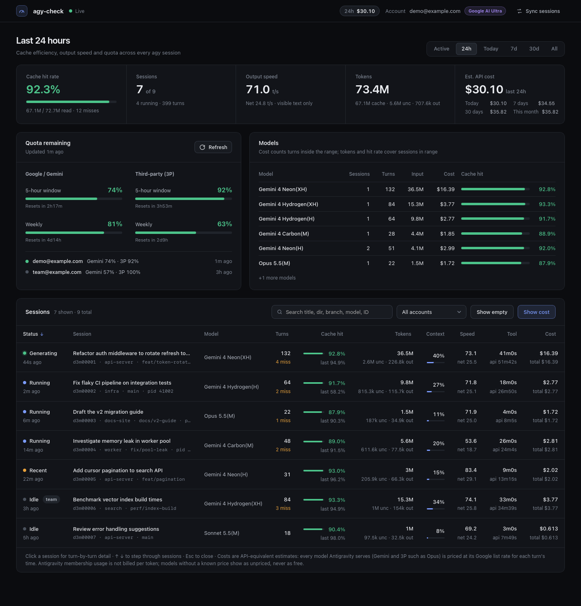
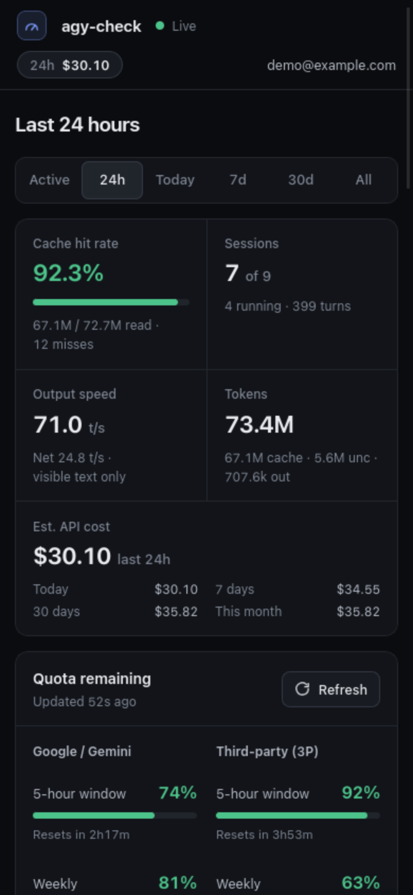
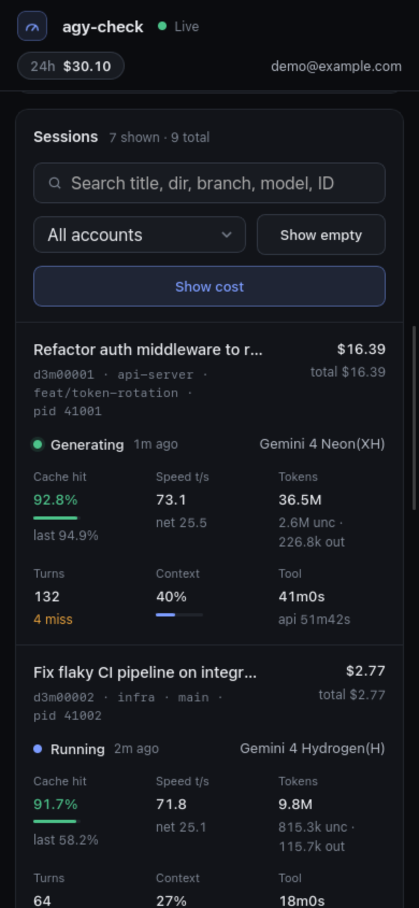
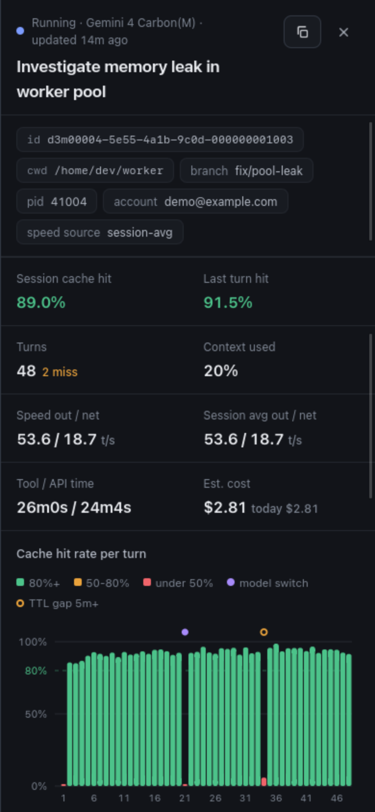
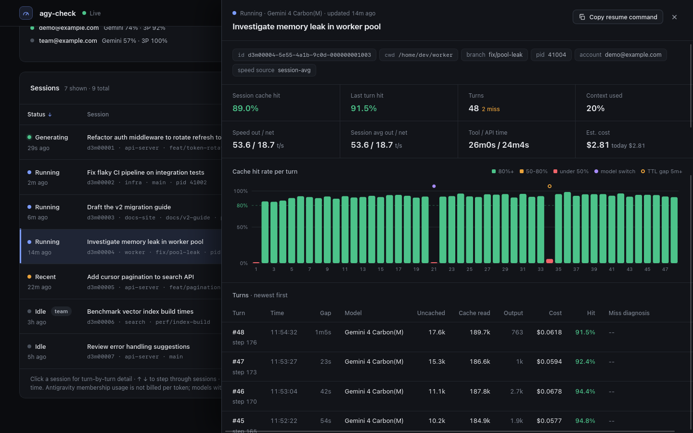
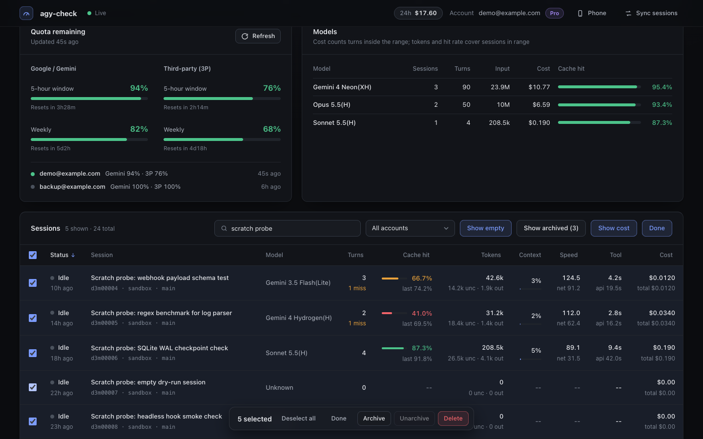
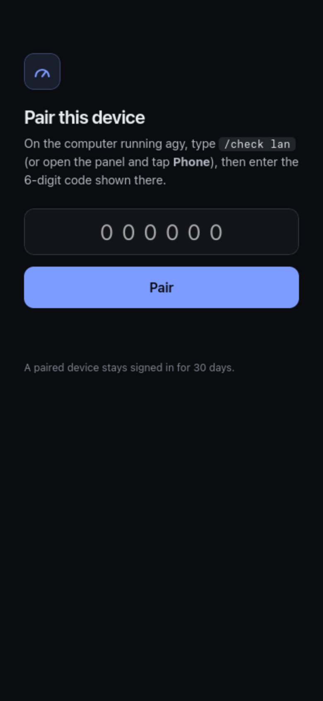
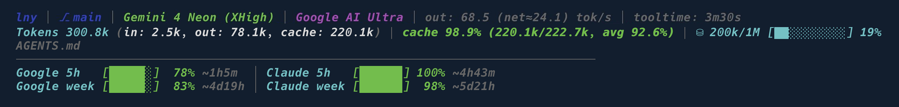

# agy-check

[](./LICENSE)

**Monitor and manage every Antigravity CLI (`agy`) session across all your devices — locally, over LAN/VPN, or on a remote server.** Check cache hit rate, output speed, tool time, context use, remaining quota, and estimated cost from your terminal status line, desktop browser, laptop, tablet, or phone, all synced live. Rename, archive, or bulk-delete sessions from whichever screen is in front of you.

[中文文档](./README_zh.md)



<p align="center">
  
  
  
</p>

<sub>Desktop, laptop, tablet and phone views stay synced live via Server-Sent Events. All screenshots use synthetic demo data.</sub>

---

## Multi-device & server access at a glance

| Setup / Surface | How to open | What you can do |
|---|---|---|
| **Phone & Tablet (LAN / VPN)** | `/check lan` → 6-digit pairing code | Watch live sessions, quota, speed and costs from iOS/Android (supports Add to Home Screen & 30-day sign-in); rename, archive, or bulk-delete sessions away from your desk |
| **Remote / Headless Server → Multi-Device** | `agy-check panel --daemon --lan --networks <cidr>` or SSH tunnel | Run `agy` on a remote workstation, homelab, or cloud VM and view/manage every session live from your laptop, tablet, and phone over WireGuard/Tailscale/LAN or SSH |
| **Desktop WebUI** | `/check` inside `agy`, or `agy-check panel` | Full multi-session dashboard: per-account quota, cost by time range, per-turn cache-miss diagnosis, search + Select All bulk archive/delete, and Keychain account sync |
| **Terminal Status Line** | Bottom of every `agy` session | Live output speed (`out` / `net≈`), tool time, per-turn & session cache hit rate, context window, 5-hour and weekly quota |
| **CLI & Slash Commands** | `/check ls`, `agy-check ls` / `session` / `sync` | Zero-token slash commands inside `agy` and plain-text terminal tables |

Everything runs directly on the machine running `agy` from files `agy` already writes — no cloud relay, no runtime dependencies, no telemetry. The dashboard binds to `127.0.0.1` by default, and `/check lan` (or `--lan --networks <cidr>`) enables authenticated multi-device viewing across your trusted LAN or VPN overlay whenever you need it.

---

## Install

Run these from a normal shell, **not** inside an active `agy` session (`agy` may rewrite `settings.json` from memory when it exits).

**macOS / Linux**
```bash
bash <(curl -fsSL https://raw.githubusercontent.com/kid0114/agy-check/main/scripts/install.sh)
```

**Windows PowerShell**
```powershell
irm https://raw.githubusercontent.com/kid0114/agy-check/main/scripts/install.ps1 | iex
```

**Windows CMD**
```cmd
powershell -ExecutionPolicy Bypass -Command "irm https://raw.githubusercontent.com/kid0114/agy-check/main/scripts/install.ps1 | iex"
```

**From a local clone**
```bash
git clone https://github.com/kid0114/agy-check.git
cd agy-check
agy plugin install .
node scripts/bootstrap.js
```

The installer:

1. Installs the plugin (`plugin.json` and the `/hud-config` skill) with `agy plugin install`.
2. Copies the runtime to `~/.gemini/antigravity-cli/agy-hud-runtime/`.
3. Sets `statusLine.command` in `~/.gemini/antigravity-cli/settings.json`.
4. Adds the `agy-hud-invocation-timer` hooks (`PreInvocation`, `PostToolUse`, `PostInvocation`) to `~/.gemini/config/hooks.json`, keeping any hooks you already have. These power `out`, `net≈` and `tooltime`.
5. Adds the `agy-check-slash-command` `PreInvocation` hook and the `/check` skill (`~/.gemini/config/skills/check/SKILL.md`). If you already have your own skill named `check`, it is left untouched and the `/check` entry is skipped from the slash-command menu; typing `/check` still works through the hook.

Running it again is safe and updates or repairs the setup. Open a new `agy` session to see the status line.

---

## Dashboard

Inside `agy`, type:

```text
/check
```

A hook answers `/check` before any model call, so it costs no tokens. It starts the dashboard in the background, or reuses one that is already running, and opens `http://127.0.0.1:18721`.

| Command | What it does |
|---|---|
| `/check` or `/check panel` | Start or reuse the dashboard and open it in your browser |
| `/check ls [active\|24h\|today\|7d\|30d\|all]` | Print the session table in the chat |
| `/check session [id]` | Per-turn cache detail for one session (defaults to the current one) |
| `/check refresh` | Refresh quota, then print the session table |
| `/check sync [--apply]` | Preview the account sync, or run it with `--apply` |
| `/check lan [--networks <cidr,...>\|none] [--revoke]` | Enable multi-device LAN/VPN access (phones, tablets, laptops, or remote servers): prints addresses and a 6-digit pairing code (see below) |
| `/check stop` | Stop the background dashboard |

### What's on the page

- **Time range** (Active, 24h, Today, 7d, 30d, All) drives every number on the page, including the cost shown in the top bar.
- **Summary**: weighted cache hit rate, session count, average output speed, tokens, and estimated API cost with Today / 7 days / 30 days / This month alongside.
- **Quota**: 5-hour and weekly remaining for the Gemini and third-party (3P) allowances, with reset times. With more than one account, each account gets its own row.
- **Models**: sessions, turns, input tokens, cost and cache hit rate per model.
- **Sessions**: status, title, directory and branch, model, turns and cache misses, hit rate (session and last turn), tokens, context use, speed, tool and API time, and cost. Click a column header to sort. You can also search, filter by account, show empty or archived sessions, or toggle **Select** to pick multiple rows and archive, unarchive, or permanently delete them in bulk.
- **Session detail**: click a row to open it. `↑` / `↓` move between sessions, `F2` (or clicking the title / pencil icon) renames the session, and `Esc` closes the panel. Save is a synchronous request: the dashboard writes the title to `agy`'s own source of truth before it answers, so `/resume`, the dashboard and the CLI keep the new name after any refresh. It uses `agy`'s documented `ConversationService/UpdateConversation` API when a live `agy` loopback connection is available (inherited at start or handed off with `agy-check panel handoff`, never sent to the browser); otherwise it updates the `title` field in `annotations/<id>.pbtxt`, leaving pinned, starred, tags and other fields untouched. **Archive / Unarchive** works the same way. **Delete** permanently removes sessions through `agy`'s `DeleteConversation` API (requires typing `DELETE`; if a selected session is still open in an `agy` window, the dialog lists the window and lets you explicitly close it before deleting; if no `agy` API connection is available, Delete is disabled and shows `agy-check panel handoff`).





The page stays in sync through Server-Sent Events whenever an `agy` transcript, `conversation_summaries.db` (including WAL updates from `/rename`), `annotations/`, `conversations/`, or `presence/` changes, so numbers, titles and running status update within about a second. A 20-second heartbeat detects silently stalled connections (such as a phone or laptop waking from sleep), refetches on reconnect or tab focus, and falls back to 5-second polling while reconnecting; clicking the **Live** pill forces an immediate sync. While at least one dashboard tab is open, cloud quota refreshes quietly in the background every 3 minutes. If the panel restarts with a newer interface, a dismissible notice invites you to refresh manually rather than reloading the page unexpectedly. A turn that is still being generated is counted once `agy` writes it to the transcript. Your time range, sort order, empty/archived filters and cost toggle are remembered in the browser (`Select` mode always starts off).

### Multi-device and remote server access

Open the same live dashboard from a phone, tablet, or second computer — either on your local Wi-Fi/Ethernet or against a remote/headless server running `agy` — with no cloud account or third-party tunnel required.

#### 1. Same LAN (Wi-Fi / Ethernet)

Inside `agy`, type `/check lan` (or run `agy-check panel --daemon --lan` in a shell). This switches the dashboard into multi-device mode and prints the addresses to open (such as `http://192.168.1.20:18721/`) plus a 6-digit pairing code:

1. Open the address on your phone, tablet, or another computer. Until the device is paired, the page only asks for the code.
2. Enter the code. It is valid for 10 minutes, works once, and is cancelled after five wrong tries.
3. The device then stays signed in for 30 days; after that it shows the pairing page again. It can also be added to the home screen (PWA). A home-screen app keeps its own sign-in, so pair it once from there.

#### 2. Remote / headless server (VPN overlay or SSH tunnel)

If you run `agy` on a remote workstation, homelab server, or cloud VM, you can view and manage its sessions across your laptop, tablet, and phone in two safe ways:

- **Over a VPN overlay (WireGuard / Tailscale / ZeroTier) or custom server subnet** — save the allowed CIDR once and pair any number of devices with a 6-digit code (no SSH client needed on phones):
  ```bash
  # On the server (example: WireGuard subnet or Tailscale 100.64.0.0/10; comma-separated for multiple)
  agy-check panel --daemon --lan --networks 10.0.0.0/24
  # Or inside agy:
  /check lan --networks 10.0.0.0/24
  ```
  On Linux servers whose Ethernet NIC uses predictable names (such as `ens*` or `enp*` instead of `eth*`), adding the server's LAN CIDR via `--networks` enables that interface too.
- **Over an SSH tunnel (keeps the server bound to `127.0.0.1` only)** — no `--lan` mode or pairing code needed for laptop access:
  ```bash
  # On the server:
  agy-check panel --daemon
  # On your laptop:
  ssh -L 18721:127.0.0.1:18721 user@your-server
  ```
  Then open `http://127.0.0.1:18721` locally.

On the host machine, the **Phone** button in the top bar shows reachable addresses and a fresh pairing code, the number of signed-in devices, and **Sign out all phones** (or run `agy-check panel pair` / `agy-check panel revoke` over SSH on a headless server). On phones, sessions show as responsive cards (respecting **Show cost** and hiding checkboxes until **Select** is toggled), the detail panel fills the screen with a dedicated **Archive / Delete / Copy** action bar below the title, and confirmation dialogs track `visualViewport` so inputs stay above the iOS keyboard.

<p align="center">
  
</p>

- Only physical Wi-Fi/Ethernet (`en*`, `eth*`, `wlan*`, `wl*`) addresses are served by default. VM bridges and VPN tunnels are neither listed nor answered unless their CIDR is saved via `--networks <cidr,...>` (`none` clears saved networks).
- Paired devices can view everything, refresh quota, rename, archive and delete sessions. Account sync, pairing codes and sign-out work only on the host running `agy`.
- Each paired device gets a random HttpOnly cookie; only its SHA-256 hash is stored, together with saved networks, in `~/.gemini/antigravity-cli/agy-hud-panel-lan.json` (mode `0600`, readable only by you), so devices stay signed in across restarts. `/check lan --revoke` or `agy-check panel revoke` signs out every paired device.
- `/check stop` turns the dashboard off; the next plain `/check` starts it for `127.0.0.1` only, and `/check lan` turns multi-device mode back on with existing paired devices still signed in.
- Traffic is plain HTTP. Use `--lan` only inside a trusted LAN or encrypted VPN overlay (WireGuard/Tailscale/ZeroTier), or use an SSH tunnel — never forward port `18721` to the public internet.

### Why a turn missed the cache

A turn is flagged when its hit rate is below 50%, or when it fell 25 points or more from the previous turn and is below 80%. The detail panel then names the likely cause:

| Diagnosis | Rule |
|---|---|
| Model switch | The model differs from the previous turn's |
| Idle gap (TTL) | 5 minutes or more passed since the previous turn |
| Context drop | The prompt is more than 25% smaller than the previous turn's (compaction or reset) |
| Prefix change / eviction | None of the above |

### Estimated cost

Each turn is priced at the list rate in effect when it ran:

$$\text{cost} = \text{uncached input} \times r_\text{in} + \text{cache reads} \times r_\text{cache} + \text{cache writes} \times r_\text{write} + \text{output (incl. thinking)} \times r_\text{out}$$

`agy` serves every model through Antigravity, so the rates are Google's: the Gemini API paid tier for Gemini models, and Google Cloud's partner-model rates for third-party models such as Opus. Prices per million tokens, global region, last checked 2026-11-23:

| Model | Input | Cached input | Output | Cache write |
|---|---|---|---|---|
| Gemini 4 Neon | $3.00 | $0.15 | $15.00 | – |
| Gemini 4 Hydrogen | $1.50 | $0.075 | $7.50 | – |
| Gemini 4 Carbon / Argon | $2.00, then $4.00 from 2026-12-01 | $0.10, then $0.20 | $10.00, then $20.00 | – |
| Gemini 3.8 Flash | $0.75, then $1.50 from 2027-01-01 | $0.075, then $0.15 | $3.75, then $7.50 | – |
| Opus 5.5 | $4.00 | $0.20 | $20.00 | $5.00 |
| Sonnet 5.5 | $2.00 | $0.10 | $10.00 | $2.50 |

- Scheduled price changes take effect at midnight Pacific time.
- Older model families use the legacy rates kept in [`runtime/cost.js`](./runtime/cost.js), which is also the place to update prices.
- A model with no known price is shown as **unpriced** and left out of totals. It is never counted as free.
- The 24h, 7d and 30d ranges are rolling windows, and Today and This month use your local calendar. These ranges only count turns inside the window. Active and All count whole sessions.
- These figures are what the tokens would cost at API prices. Usage covered by an Antigravity membership is not billed per token.

### CLI

The CLI lives in the installed runtime. Put it on your `PATH` once:

```bash
ln -s ~/.gemini/antigravity-cli/agy-hud-runtime/runtime/bin/agy-check.js ~/.local/bin/agy-check
```

```text
agy-check panel [--port 18721] [--daemon] [--open]   Start the dashboard (127.0.0.1)
   [--lan] [--networks <cidr,...>|none]              Multi-device mode: LAN + saved VPN/server CIDRs with pairing code
agy-check panel pair | revoke                        New pairing code | sign out all paired devices
agy-check panel handoff                              Hand this agy window's loopback API connection to the panel (for permanent delete)
agy-check panel stop                                 Stop the background dashboard
agy-check ls [--range 24h] [--sort recent]           Print the session table
   [--account all|unsynced|email] [--q text] [--limit 20] [--refresh] [--json]
agy-check session <id-prefix> [--json]               Per-turn cache hit rate and miss diagnosis
agy-check sync [--apply]                             Preview (default) or run the account sync
agy-check config                                     Status line configuration wizard
agy-check update                                     Update the runtime
```

---

## Accounts and account sync

- Quota is saved per account every time it is refreshed while that account is logged in. With two accounts, the Quota card lists both. The one you are not logged into shows its last saved values and how old they are. Only the logged-in account has live quota, because `agy` keeps a single login in the macOS Keychain.
- After you switch accounts, `agy` windows that were already open keep the old login in memory. They keep using the old account and can write it back into the Keychain. agy-check marks those sessions **unsynced** in the dashboard, the CLI and their own status line, and shows a banner.
- **Sync sessions** (optional) hands this situation to a script you provide. agy-check runs it with `--dry-run` to show a preview, and runs it for real only after you confirm. The script path comes from `AGY_SYNC_SCRIPT`, or defaults to `~/tool-scripts/agy/agy-sync-keychain.sh`. The script is not part of this repository, and the button stays hidden when it is missing. A typical script stops the other interactive `agy` windows and reopens their conversations in new terminal tabs. Check what yours does before you confirm.

---

## Status line



```text
user@gmail.com │ project │ ⎇ main │ Gemini 4 Neon (XHigh) │ Google AI Ultra │ out: 68.5 (net≈24.1) tok/s │ tooltime: 3m30s
⚿ Tokens 300.8k (in: 2.5k, out: 78.1k, cache: 220.1k) │ cache 98.9% (220.1k/222.7k, avg 92.6%) │ ⛁ 200k/1M [██░░░░░░░░] 19%
1 AGENTS.md
  ─────────────────────────────────────────────────────────────────────────────────
  Google 5h   [█████░]  78% ~1h5m  │ Claude 5h   [██████] 100% ~4h43m
  Google week [█████░]  83% ~4d19h │ Claude week [██████]  98% ~5d21h
```

Compared with upstream [`agy-hud`](https://github.com/icebear0828/agy-hud):

| Capability | Upstream `agy-hud` | `agy-check` |
|---|---|---|
| **Output speed (`out` / `net≈`)** | Total `tok/s` from a coarse fallback or cost duration | Timed by hooks, excluding tool time. Shows both total speed (with thinking) and visible net speed `net≈` |
| **Tool time (`tooltime`)** | Not available | Total tool runtime for the session, wired through `~/.gemini/config/hooks.json` |
| **Cache hit rate (`cache`)** | Opt-in. A heuristic miscounted turns where `input_tokens >= cache_read`, and 0% turns could be hidden by smoothing | On by default. Uses agy's exact denominator `input + cache_read + cache_write`, reports cold turns honestly as `0.0%`, and adds a whole-session `avg` |
| **Transcript parsing** | Failed on legacy `~/.gemini/antigravity/brain/...` paths and top-level `PLANNER_RESPONSE` token fields | Resolves the conversation UUID to `antigravity-cli/brain/<id>/.../transcript.jsonl` and reads the native token fields |
| **Account switching** | Could briefly show the previous account's tier and quota | Caches quota and tier per account email and refreshes immediately after a switch |

### How each metric is calculated

All values come from `agy`'s status line JSON on stdin, `transcript.jsonl` / `transcript_full.jsonl`, hook timestamps in `~/.gemini/antigravity-cli/speed-cache/hook-timing-<id>.json`, and the Antigravity quota API.

**Line 1: identity, speed and tool time**

| Item | Example | Source and formula |
|---|---|---|
| **Account** | `user@gmail.com` | First match of: the live OAuth token's cached userinfo email, `~/.gemini/google_accounts.json`, the JWT payload in `~/.gemini/oauth_creds.json` (display only), then the OS username. Toggle with `display.showUsername`. |
| **Workspace** | `project` | `path.basename(agyData.workspace.current_dir \|\| cwd)`. Toggle with `display.showCurrentDir`. |
| **Git branch** | `⎇ main` | `git rev-parse --abbrev-ref HEAD` in the workspace. Toggle with `display.showGitBranch`. |
| **Model** | `Gemini 4 Neon (XHigh)` | `agyData.model.display_name \|\| agyData.model.id`, shortened for common Gemini, Claude and GPT-OSS names. |
| **Plan tier** | `Google AI Ultra` | Tier from `loadCodeAssist`, cached per account email, falling back to `agyData.plan_tier \|\| 'Free'`. |
| **Output speed (`out`)** | `out: 68.5 tok/s` | $$\text{out} = \frac{\Delta \text{total\_output\_tokens}}{\Delta t_{\text{model}}}$$ where $\Delta t_{\text{model}}$ is the invocation time measured by `invocation-timer.js` hooks minus tool time. Includes thinking tokens. Readings under 500 ms are ignored as noise, and the last valid reading is held until the next response. |
| **Visible speed (`net≈`)** | `(net≈24.1)` | $$\text{net} \approx \frac{\min(\Delta \text{total\_output\_tokens},\; \Delta \text{visible\_tokens})}{\Delta t_{\text{model}}}$$ Visible tokens (excluding hidden thinking) are estimated from `PLANNER_RESPONSE.content` and `tool_calls` as $\text{CJK chars} \times 0.9 + \text{other chars} \times 0.26$, capped per step by `entry.output_tokens`. |
| **Tool time (`tooltime`)** | `tooltime: 3m30s` | Summed over the session. For each invocation with `PostToolUse` markers, the window runs from the first tracked tool step's `created_at + 500ms` (compensating for whole-second timestamps) to the last `PostToolUse` completion, clamped to the invocation. |

**Line 2: tokens, cache hit rate and context window**

| Item | Example | Source and formula |
|---|---|---|
| **Tokens** | `⚿ Tokens 300.8k (in: 2.5k, out: 78.1k, cache: 220.1k)` | `in`: this turn's uncached input (`current_usage.input_tokens`, or `max(0, total_input_tokens - cacheTotal)` when missing). `out`: session output `context_window.total_output_tokens`. `cache`: `cache_read_input_tokens + cache_creation_input_tokens`, hidden when 0. `Tokens`: `in + out + cache`. |
| **Turn cache hit rate** | `cache 98.9% (220.1k/222.7k, ...)` | $$\frac{\text{cache\_read}}{\text{input\_tokens} + \text{cache\_read} + \text{cache\_creation}} \times 100\%$$ Only input can hit the cache; output is decoded fresh every turn. In `agy`, `input_tokens` is always the uncached part, so the total prompt is `input + cache_read + cache_write`. A missing `cache_read` counts as 0 and shows `0.0%`. |
| **Session average (`avg`)** | `(..., avg 92.6%)` | $$\frac{\sum \text{cache\_read}}{\sum (\text{input} + \text{cache\_read} + \text{cache\_creation})} \times 100\%$$ over every `PLANNER_RESPONSE` in the session, from the second turn on. Turn off with `display.showSessionCacheHitRate: false`. |
| **Cache colours** | Green / yellow / grey | `display.cacheHitThresholds` defaults: ≥ 80% bold green, 50–79.9% yellow, 0.1–49.9% dim yellow, 0% dim grey. |
| **Context window** | `⛁ 200k/1M [██░░░░░░░░] 19%` | `context_window.total_input_tokens / context_window.context_window_size` and `used_percentage`. The bar turns yellow above `thresholds.warning` (70%) and red above `thresholds.critical` (90%). |

**Line 3: workspace files** (shown only when something is found): memory files (`AGENTS.md`, `GEMINI.md`, `CLAUDE.md`, `MEMORY.md`), rule files (`.gemini/rules`, `.claude/rules`, `.cursor/rules`, `.github/rules`), configured MCP servers, and active `.git/hooks` scripts.

**Quota table**

| Item | Example | Source and formula |
|---|---|---|
| **Remaining %** | `Google 5h [█████░] 78%` | `agy`'s stdin `quota` map (`gemini-5h`, `gemini-weekly`, `3p-5h`, `3p-weekly`) merged with the cached Antigravity quota (`agy-hud-quota-cache.json`). Uses `floor(remainingFraction × 100)`, capped at 99% while any of the window is used. |
| **Reset countdown** | `~1h5m` / `~4d19h` | `max(0, resetTime - now)`, shown as `Xd`, `XdYh`, `Xh`, `XhYm`, `Ym` or `now`. |

---

## Configuration

Global config: `~/.gemini/antigravity-cli/agy-hud-runtime/runtime/agy-hud.config.json`
Per-project override (optional): `./agy-hud.config.json`

Interactive wizard:
```bash
node ~/.gemini/antigravity-cli/agy-hud-runtime/runtime/bin/agy-hud.js --config
```

Or edit the file directly:

```json
{
  "theme": {
    "primary": "green",
    "secondary": "gray",
    "warning": "yellow",
    "critical": "red"
  },
  "display": {
    "showTokenBar": true,
    "showBreadcrumbs": true,
    "showGitBranch": true,
    "showCurrentDir": true,
    "breadcrumbCount": 3,
    "useNerdFonts": false,
    "showUsername": true,
    "showSpeed": true,
    "showToolTime": true,
    "showTurnCacheHitRate": true,
    "showSessionCacheHitRate": true,
    "cacheSmoothing": false,
    "quotaStyle": "table",
    "showCost": false,
    "showDailyCost": false,
    "showWeeklyCost": false
  },
  "thresholds": {
    "warning": 0.7,
    "critical": 0.9
  },
  "language": "auto"
}
```

| `display` option | Default | Description |
|---|---|---|
| `showSpeed` | `true` | Show `out: X.X (net≈Y.Y) tok/s` on line 1 |
| `showToolTime` | `true` | Show `tooltime: XmYs` on line 1 |
| `showTurnCacheHitRate` | `true` | Show the `cache XX.X% (read/total)` badge on line 2 |
| `showSessionCacheHitRate` | `true` | Append the session `avg YY.Y%` (from the second turn on) |
| `cacheHitThresholds` | `{ "excellent": 80, "partial": 50 }` | Colour breakpoints for the cache badge |
| `cacheSmoothing` | `false` | Legacy smoothing for older CLI versions; keep `false` to see real `0.0%` misses |
| `quotaStyle` | `"table"` | `"table"` (5h and week per provider), `"compact"` (one line of mini bars) or `"models"` (per-model table) |
| `showUsername` | `true` | Show the account email or OS username |
| `useNerdFonts` | `false` | Use Nerd Font glyphs instead of standard Unicode symbols |
| `showCost` / `showDailyCost` / `showWeeklyCost` | `false` | Show estimated session, daily and weekly cost in the status line |

---

## Data and privacy

agy-check only reads local files that `agy` and its own hooks write:

- `~/.gemini/antigravity-cli/brain/<id>/.system_generated/logs/transcript.jsonl`: turns, token counts, timestamps.
- `~/.gemini/antigravity-cli/conversation_summaries.db`: conversation titles and step counts (queried with `PRAGMA query_only = ON`, and updated in a transaction only when you rename a session from the dashboard, keeping `title`, `raw_summary` and `conversations_fts` in sync). This is an index that `agy` regenerates, so it is never the only place a rename is written.
- `~/.gemini/antigravity-cli/annotations/<id>.pbtxt`: `agy`'s user-editable conversation metadata. Updated atomically (only `title` or `archived`, leaving other fields intact) when you rename or archive a session and `agy`'s local API is not available.
- `~/.gemini/antigravity-cli/conversations/<id>.db` and `presence/<id>.lock`: inspected (never modified directly) to detect which interactive `agy` window holds a conversation and to filter out deleted ghost rows left in `conversation_summaries.db`.
- `~/.gemini/antigravity-cli/agy-check-ls-endpoints.json` (mode `0600`): loopback addresses and CSRF tokens handed off by `agy-check panel handoff`, kept strictly server-side and verified against live `agy` listener PIDs before use.
- `~/.gemini/antigravity-cli/speed-cache/` and `sessions/`: hook timings and per-session snapshots written by agy-check (cleaned when a session is deleted from the dashboard).
- `~/.gemini/antigravity-cli/agy-hud-accounts-quota.json`: saved quota per account.
- The macOS Keychain item `gemini / antigravity`: read to know which account is active and to request quota. Tokens are never printed.

The dashboard binds to `127.0.0.1` only, unless you turn on multi-device access with `/check lan` (see [Multi-device and remote server access](#multi-device-and-remote-server-access)). Its write actions (quota refresh, session rename, archive, delete and sync) reject cross-origin requests, and sync never runs for other devices. The only network requests go to Google's Antigravity quota and userinfo endpoints, made with the active login, plus a once-a-day version check against this repository's `package.json` on GitHub. Renames, archives and deletes may also call `agy`'s own language server on a loopback address. There is no telemetry.

---

## Troubleshooting

```bash
# Check the status line and hook configuration
cat ~/.gemini/antigravity-cli/settings.json | grep -A3 statusLine
cat ~/.gemini/config/hooks.json

# Render the status line directly
node ~/.gemini/antigravity-cli/agy-hud-runtime/runtime/bin/agy-hud.js < /dev/null

# Start the dashboard in the foreground to see its log
node ~/.gemini/antigravity-cli/agy-hud-runtime/runtime/bin/agy-check.js panel

# Run the unit tests (from the repository root)
npm test
```

---

## Uninstall

Stop the dashboard first if it is running (`/check stop` or `agy-check panel stop`).

**macOS / Linux**
```bash
bash <(curl -fsSL https://raw.githubusercontent.com/kid0114/agy-check/main/uninstall.sh)
```

**Windows PowerShell**
```powershell
irm https://raw.githubusercontent.com/kid0114/agy-check/main/uninstall.ps1 | iex
```

This removes `statusLine` from `settings.json`, removes the `agy-hud-invocation-timer` and `agy-check-slash-command` hooks from `hooks.json` (other hooks are left alone), removes the `/check` skill this tool installed (a `check` skill you wrote yourself is kept), deletes `agy-hud-runtime` and its caches, and uninstalls the plugin.

---

## License and attribution

Licensed under the [MIT License](./LICENSE).

Originally based on [`icebear0828/agy-hud`](https://github.com/icebear0828/agy-hud) (MIT). All upstream credit belongs to its authors.
