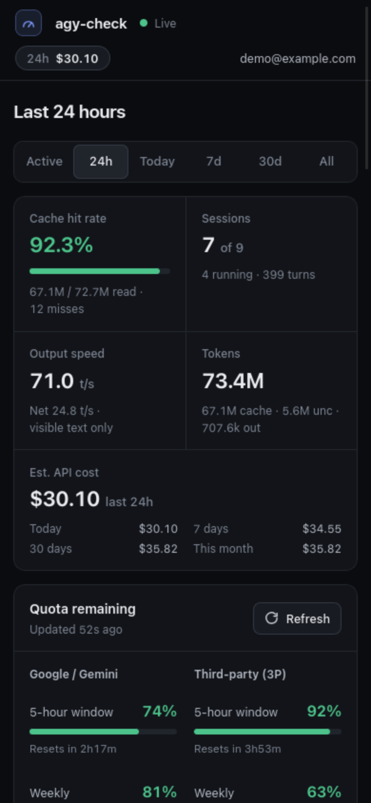
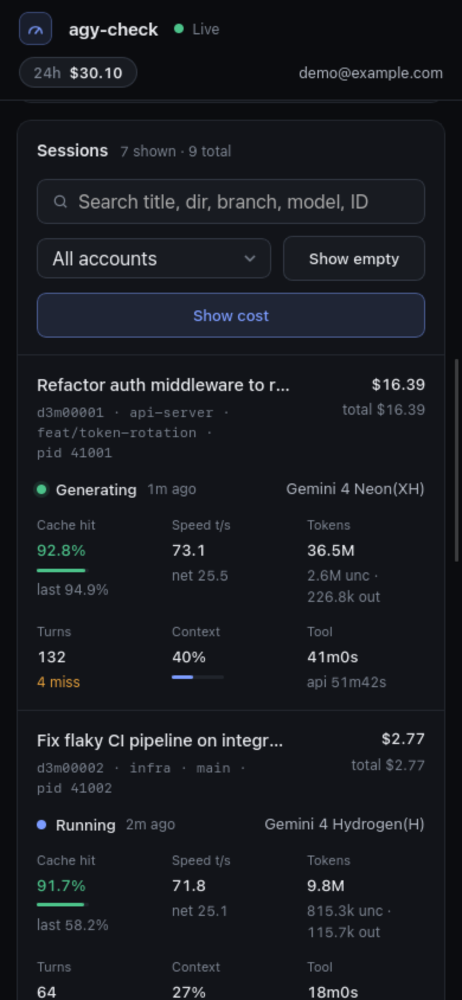
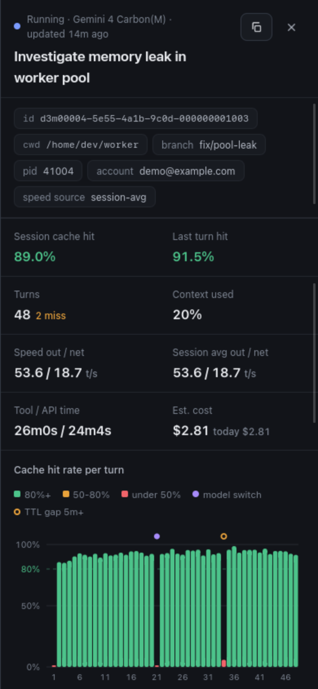
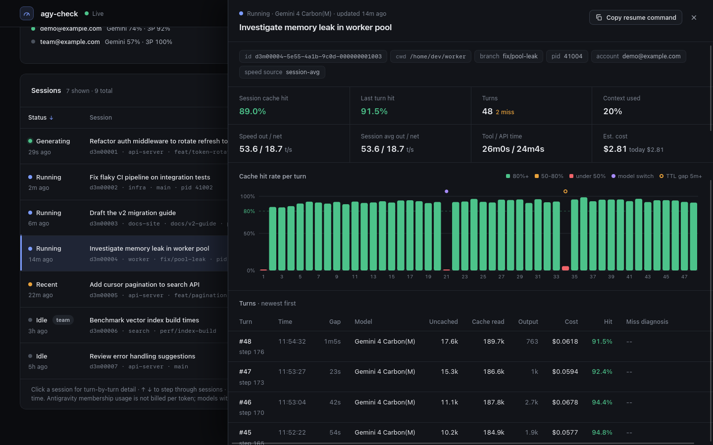
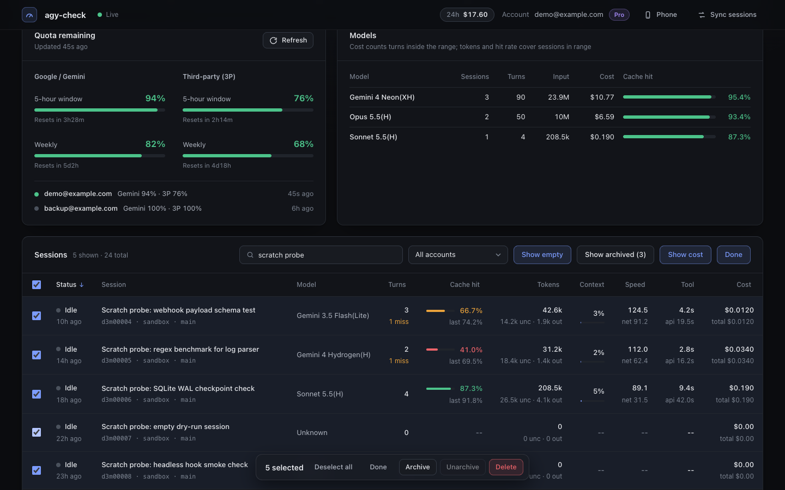

# agy-check

[](./LICENSE)

**跨多端实时查看与管理所有 Antigravity CLI（`agy`）会话——支持电脑、手机、平板、局域网 / TUN 虚拟组网，以及远程服务器部署。** 无论身在哪个屏幕前，都能实时同步查看缓存命中率、输出速度、工具耗时、上下文占用、剩余配额与估算费用，并随时重命名、归档或批量删除会话。

[English](./README.md)


<p align="center">
  
  
  
</p>

<sub>电脑端、平板与手机端通过 Server-Sent Events 实时同步。所有截图均为虚构的演示数据。</sub>

---

## 核心优势

- **多端与远程服务器实时同步**：终端状态栏、电脑浏览器、手机/平板（PWA、6 位配对码、30 天免重登）、局域网、TUN 虚拟组网（Tailscale / ZeroTier / WireGuard）及无头服务器（`--lan --networks <cidr>` 或 SSH 隧道）全打通。
- **任意屏幕直接管理会话**：搜索筛选、持久化重命名（同步回写 `agy` 真实数据源，`/resume` 立即可见）、归档 / 取消归档，以及 **Select** 多选 / 全选批量归档与安全永久删除（检测运行中窗口并二次确认）。
- **多账号与缓存洞察**：多账号 5h / 每周配额对照、切号残留 `unsynced` 窗口告警、按时间范围估算 API 费用、自动标注缓存未命中原因。
- **开箱即用、纯本地零负担**：零运行时依赖、`agy` 内 `/check` 零 token 响应、无遥测，默认仅监听 `127.0.0.1`。

| 想在哪里看 | 启动命令 | 说明 |
|---|---|---|
| **本机电脑** | `/check`（或 `agy-check panel`） | 打开 `http://127.0.0.1:18721` |
| **手机 / 平板（同局域网）** | `/check lan` | 输出局域网地址 + 6 位配对码（30 天免重登，支持 PWA） |
| **远程 / 无头服务器（TUN / 局域网）** | `agy-check panel --daemon --lan --networks 10.0.0.0/24` | 通过 TUN 虚拟网段（Tailscale / ZeroTier / WireGuard）或 Linux 服务器局域网跨端直连 |
| **远程服务器（SSH 隧道）** | `ssh -L 18721:127.0.0.1:18721 user@server` | 服务器仅监听 `127.0.0.1`，本机访问 `http://127.0.0.1:18721` |
| **终端 / 命令行** | 底部状态栏、`/check ls`、`agy-check ls` | 实时速度、工具耗时、缓存命中、配额与纯文本会话表 |

---

## 多端与服务器配置查看

无需云账号或第三方内网穿透，按 `agy` 所在位置选择对应方式即可：

### 1. 本机查看（默认）

在 `agy` 中输入 `/check`（由 Hook 在调用模型前直接拦截，不消耗 token）。它会在后台启动或复用 `http://127.0.0.1:18721` 并自动打开浏览器。

### 2. 同一局域网多端查看（手机 / 平板 / 另一台电脑）

在 `agy` 中输入 `/check lan`（或在终端运行 `agy-check panel --daemon --lan`），会输出局域网访问地址（例如 `http://192.168.1.20:18721/`）和一个 6 位配对码：

1. 在手机、平板或另一台电脑上打开地址，输入 6 位配对码（10 分钟内有效、单次使用、输错 5 次作废）。
2. 配对后通过随机 HttpOnly Cookie 保持 30 天免重登（磁盘仅保存 SHA-256 哈希于权限 `0600` 的 `agy-hud-panel-lan.json`）。可添加到主屏幕作为 PWA 使用（主屏幕应用需单独配对一次）。
3. 随时可通过宿主机顶栏 **Phone** 按钮，或命令行 `agy-check panel pair` / `/check lan --revoke` 发放新配对码或踢出全部设备。

<p align="center">
  
</p>

### 3. 远程 / 无头服务器接入（TUN 组网或 SSH 隧道）

如果你的 `agy` 跑在远程 Linux/macOS 服务器、HomeLab 或云主机上，有两种安全方式接入多端查看：

- **TUN 虚拟组网（Tailscale / ZeroTier / WireGuard）或服务器局域网段**——保存一次允许的网段 CIDR，手机、平板与笔记本都可凭 6 位配对码直接访问（手机无需 SSH 客户端）：
  ```bash
  # 在服务器上运行（示例：TUN 虚拟网段或 Tailscale 的 100.64.0.0/10，多网段逗号分隔）
  agy-check panel --daemon --lan --networks 10.0.0.0/24
  # 或在 agy 内运行：
  /check lan --networks 10.0.0.0/24
  ```
  <sub>`--lan` 默认只响应物理网卡（`en*` / `eth*` / `wlan*` / `wl*`），虚拟机网桥和未授权 TUN 网卡均返回 `403`。通过 `--networks` 添加网段既可用于 TUN 虚拟组网，也可覆盖 Linux 现代网卡名（如 `ens*` / `enp*`）；传 `--networks none` 可清空。</sub>
- **SSH 端口转发（服务器仅监听 `127.0.0.1`）**——适合电脑端快速查看，服务器无需开放任何非回环端口：
  ```bash
  # 在服务器上：
  agy-check panel --daemon
  # 在本机电脑上：
  ssh -L 18721:127.0.0.1:18721 user@your-server
  ```
  随后在本机浏览器打开 `http://127.0.0.1:18721`。

> **安全说明**：已配对设备可查看全部数据、刷新配额、重命名、归档与删除会话；账号同步、生成配对码和注销设备仅限宿主机操作。传输为明文 HTTP，请仅在可信局域网或加密 TUN 组网内开启 `--lan`（或改用 SSH 隧道），切勿将 `18721` 端口直接暴露到公网。

---

## 安装

请在普通终端中运行，**不要**在正在运行的 `agy` 会话内执行（`agy` 退出时可能覆盖 `settings.json`）。重复运行可安全更新或修复。

**macOS / Linux**
```bash
bash <(curl -fsSL https://raw.githubusercontent.com/kid0114/agy-check/main/scripts/install.sh)
```

**Windows PowerShell**
```powershell
irm https://raw.githubusercontent.com/kid0114/agy-check/main/scripts/install.ps1 | iex
```

**Windows CMD**
```cmd
powershell -ExecutionPolicy Bypass -Command "irm https://raw.githubusercontent.com/kid0114/agy-check/main/scripts/install.ps1 | iex"
```

**从本地克隆安装**
```bash
git clone https://github.com/kid0114/agy-check.git
cd agy-check
agy plugin install .
node scripts/bootstrap.js
```

安装脚本会自动部署插件、运行时（`~/.gemini/antigravity-cli/agy-hud-runtime/`）、`statusLine.command`、计时 Hook 以及零 token `/check` 技能（保留你已有的 Hook 及自定义 `check` 技能）。新开一个 `agy` 会话即可看到状态栏。

---

## 面板与会话管理

- **自动实时同步**：通过 Server-Sent Events 监听 `agy` 会话日志、标题、annotations、锁文件与在线状态，变化约 1 秒内推送到所有已连接设备。内置 20 秒心跳检测、休眠唤醒自动补拉、断连 5 秒轮询兜底、点击 **Live** 手动刷新，以及有页面打开时每 3 分钟静默刷新云端配额。
- **全局总览**：统一时间范围（`Active`、`24h`、`Today`、`7d`、`30d`、`All`），展示加权缓存命中率、平均 `out`/`net≈` 速度、估算 API 费用阶梯（今天 / 7 天 / 30 天 / 本月）、多账号 5h 与每周配额及按模型拆分。
- **逐轮详情与缓存诊断**：点击任意行打开详情抽屉（`↑` / `↓` 切换、`Esc` 关闭），查看每轮命中率走势、单轮估算费用及未命中原因标注。
- **搜索、持久化重命名、归档与批量删除**：
  - 重命名（点标题 / 铅笔图标 / `F2`）与归档 / 取消归档直接写入 `agy` 真实数据源（优先调用 `ConversationService/UpdateConversation`，无本地接口时原子改写 `annotations/<id>.pbtxt`），刷新与 `/resume` 永久保持同步。
  - 点击 **Select** 开启多选（支持全选）以批量归档、取消归档或通过 `agy` 的 `DeleteConversation` 接口永久删除（需输入 `DELETE` 确认；自动识别正在打开该会话的 `agy` 窗口并允许先关闭再删；无连接时可运行 `agy-check panel handoff` 移交回环接口）。





### 常用命令

在 `agy` 内使用（零 token）：

| 斜杠命令 | 作用 |
|---|---|
| `/check` 或 `/check panel` | 启动或复用面板并在浏览器打开 |
| `/check lan [--networks <cidr,...>\|none] [--revoke]` | 开启多端局域网 / TUN 访问并输出地址与配对码 |
| `/check ls [active\|24h\|today\|7d\|30d\|all]` | 在对话中输出会话表 |
| `/check session [id]` | 查看某个会话的逐轮缓存详情（默认当前会话） |
| `/check refresh` | 刷新配额后输出会话表 |
| `/check sync [--apply]` | 预览或执行可选的账号同步 |
| `/check stop` | 停止后台面板 |

独立命令行（可选软链：`ln -s ~/.gemini/antigravity-cli/agy-hud-runtime/runtime/bin/agy-check.js ~/.local/bin/agy-check`）：

```text
agy-check panel [--port 18721] [--daemon] [--open]   启动面板（127.0.0.1）
   [--lan] [--networks <cidr,...>|none]              开启多端局域网 / TUN 模式与配对码
agy-check panel pair | revoke                        生成新配对码 | 注销所有已配对设备
agy-check panel handoff                              移交当前 agy 窗口回环接口给面板（用于永久删除）
agy-check panel stop                                 停止后台面板
agy-check ls [--range 24h] [--sort recent]           输出会话表
   [--account all|unsynced|email] [--q text] [--limit 20] [--refresh] [--json]
agy-check session <id-prefix> [--json]               逐轮缓存命中率与未命中诊断
agy-check sync [--apply]                             预览（默认）或执行账号同步
agy-check config                                     状态栏配置向导
agy-check update                                     更新运行时
```

---

## 终端状态栏与多账号同步


相比原版 [`agy-hud`](https://github.com/icebear0828/agy-hud)，状态栏新增基于 Hook 计时的输出速度（含思考总速 `out` 与扣除工具耗时后的可见净速 `net≈`）、累计工具耗时 `tooltime`、默认开启且精确计入冷启动 `0.0%` 与整会话 `avg` 的缓存命中率、原生 `antigravity-cli` 日志解析，以及按账号隔离的配额缓存。

- **多账号配额与旧窗口检测**：按账号邮箱保存配额快照，切号后仍可对照查看非活跃账号上次保存的余量；已打开但内存中仍持旧登录的 `agy` 窗口会在面板、CLI 和自身状态栏标为 **unsynced**。
- **可选账号同步脚本**：若你通过 `AGY_SYNC_SCRIPT` 提供了外部脚本（默认 `~/tool-scripts/agy/agy-sync-keychain.sh`，不在本仓库内），面板会先跑 `--dry-run` 预览，本机确认后才执行；无脚本时按钮自动隐藏。

---

## 指标来源与配置一览

| 项目 | 数据来源 | 说明 |
|---|---|---|
| **输出速度（`out` / `net≈`）与 `tooltime`** | `agy` Hook（`speed-cache/`）+ 会话日志 | 扣除工具等待时间；`out` 含思考 token，`net≈` 为可见净速 |
| **缓存命中率与未命中归因** | `transcript.jsonl` | 按 `cache_read / (input + cache_read + cache_write)` 精确计算（冷启动为 `0.0%`）；自动标出切模型、5 分钟 TTL、上下文缩减 >25% 或前缀变化 |
| **估算 API 费用** | `transcript.jsonl` + [`runtime/cost.js`](./runtime/cost.js) | 按每轮发生时的 Google 官方牌价估算；未知模型标为 **unpriced**；会员额度不按 token 计费 |
| **配额与多账号漂移** | Antigravity 配额接口 + 本地钥匙串 / 锁文件 | 按账号邮箱缓存快照；切号后仍持旧登录的窗口标为 **unsynced** |
| **标题、归档与永久删除** | `agy` 本地接口 / `annotations/*.pbtxt` | 直接同步至 `agy` 数据源；永久删除走 `DeleteConversation`（需要时用 `agy-check panel handoff`） |
| **状态栏配置** | `agy-check config` 或 `agy-hud.config.json` | 交互向导调整主题、速度 / 缓存 / 费用开关、配额样式（`table`/`compact`/`models`）及 Nerd Fonts |

---

## 隐私、排查与卸载

- **隐私**：纯本地运行、无遥测。对外请求仅限使用当前登录访问 Google Antigravity 配额 / userinfo 接口（macOS 钥匙串 token 从不打印），以及每天一次检查本仓库 GitHub `package.json` 版本。面板默认绑定 `127.0.0.1`，开启多端请见[多端与服务器配置查看](#多端与服务器配置查看)；所有写接口校验同源，`agy-check-ls-endpoints.json`（权限 `0600`）仅留存服务端。
- **排查**：
  ```bash
  node ~/.gemini/antigravity-cli/agy-hud-runtime/runtime/bin/agy-hud.js < /dev/null   # 直接测试状态栏渲染
  node ~/.gemini/antigravity-cli/agy-hud-runtime/runtime/bin/agy-check.js panel       # 前台启动面板看日志
  npm test                                                                            # 运行单元测试（仓库根目录）
  ```
- **卸载**（请先执行 `/check stop` 停止面板）：
  ```bash
  # macOS / Linux
  bash <(curl -fsSL https://raw.githubusercontent.com/kid0114/agy-check/main/uninstall.sh)
  ```
  ```powershell
  # Windows PowerShell
  irm https://raw.githubusercontent.com/kid0114/agy-check/main/uninstall.ps1 | iex
  ```
  会清理 `statusLine`、`agy-check` 自身的 Hook 与技能（保留你自己的 Hook 和同名 `check` 技能）、运行时缓存及插件。

---

## 许可与致谢

基于 [MIT License](./LICENSE) 发布。基于 [`icebear0828/agy-hud`](https://github.com/icebear0828/agy-hud)（MIT）二次开发。
