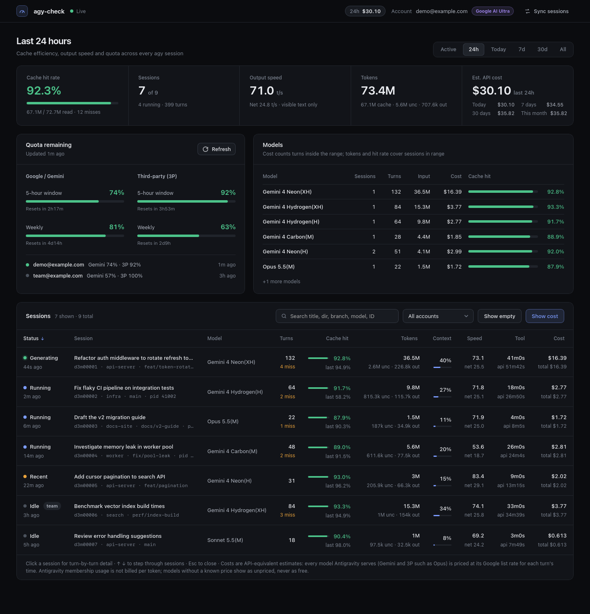
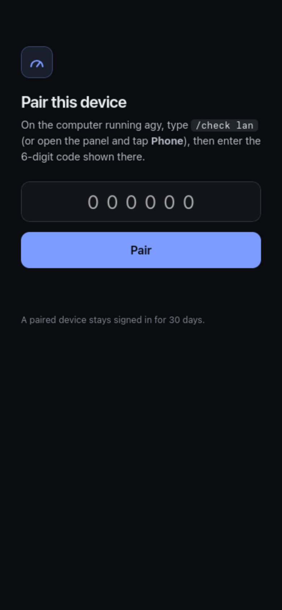
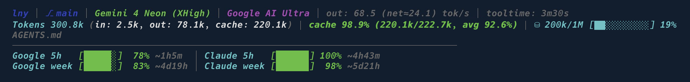

# agy-check

[](./LICENSE)

为 Antigravity CLI（`agy`）提供实时状态栏和多会话面板：缓存命中率、输出速度、工具耗时、上下文占用、剩余配额和估算费用，既能看当前会话，也能一次看全部会话。

[English](./README.md)



<sub>所有截图均为虚构的演示数据。</sub>

---

## 包含什么

| 部分 | 在哪里 | 显示什么 |
|---|---|---|
| **状态栏** | 每个 `agy` 会话底部 | 输出速度（`out` / `net≈`）、工具耗时、单轮与整会话缓存命中率、上下文窗口、5 小时与每周配额 |
| **面板** | 在 `agy` 内输入 `/check`，或运行 `agy-check panel` | 所有会话汇总在一个实时页面：缓存效率、速度、token、各账号配额、按时间范围的估算费用，以及每一轮未命中缓存的原因 |
| **命令行** | `agy-check ls` / `session` / `sync` | 同样的数据，以纯文本表格输出 |

全部在本机运行，只读取 `agy` 本来就会写入的文件。没有运行时依赖，没有遥测，面板只监听 `127.0.0.1`。

---

## 安装

请在普通终端中运行，**不要**在正在运行的 `agy` 会话里执行（`agy` 退出时可能用内存中的配置覆盖 `settings.json`）。

**macOS / Linux**
```bash
bash <(curl -fsSL https://raw.githubusercontent.com/kid0114/agy-check/main/scripts/install.sh)
```

**Windows PowerShell**
```powershell
irm https://raw.githubusercontent.com/kid0114/agy-check/main/scripts/install.ps1 | iex
```

**Windows CMD**
```cmd
powershell -ExecutionPolicy Bypass -Command "irm https://raw.githubusercontent.com/kid0114/agy-check/main/scripts/install.ps1 | iex"
```

**从本地克隆安装**
```bash
git clone https://github.com/kid0114/agy-check.git
cd agy-check
agy plugin install .
node scripts/bootstrap.js
```

安装脚本会：

1. 通过 `agy plugin install` 安装插件（`plugin.json` 与 `/hud-config` 技能）。
2. 把运行时复制到 `~/.gemini/antigravity-cli/agy-hud-runtime/`。
3. 在 `~/.gemini/antigravity-cli/settings.json` 写入 `statusLine.command`。
4. 向 `~/.gemini/config/hooks.json` 注册 `agy-hud-invocation-timer`（`PreInvocation`、`PostToolUse`、`PostInvocation`），保留你已有的 Hook。`out`、`net≈`、`tooltime` 依赖这些 Hook。
5. 注册 `agy-check-slash-command`（`PreInvocation`）Hook，并安装 `/check` 技能（`~/.gemini/config/skills/check/SKILL.md`）。如果你已有自己的同名技能 `check`，安装程序不会覆盖它，斜杠菜单里也就不会出现本工具的 `/check` 条目；直接输入 `/check` 仍会由 Hook 处理。

重复运行是安全的，会更新或修复现有安装。新开一个 `agy` 会话即可看到状态栏。

---

## 面板

在 `agy` 中输入：

```text
/check
```

`/check` 由 Hook 在调用模型之前直接处理，不消耗 token。它会在后台启动面板（已在运行则直接复用），并打开 `http://127.0.0.1:18721`。

| 命令 | 作用 |
|---|---|
| `/check` 或 `/check panel` | 启动或复用面板，并在浏览器中打开 |
| `/check ls [active\|24h\|today\|7d\|30d\|all]` | 在对话中输出会话表 |
| `/check session [id]` | 查看某个会话的逐轮缓存详情（默认当前会话） |
| `/check refresh` | 刷新配额后输出会话表 |
| `/check sync [--apply]` | 预览账号同步，加 `--apply` 则实际执行 |
| `/check lan [--networks <cidr,...>\|none] [--revoke]` | 允许同一网络中的手机使用面板：输出访问地址和配对码（见下文） |
| `/check stop` | 停止后台面板 |

### 页面内容

- **时间范围**（Active、24h、Today、7d、30d、All）决定页面上的所有数字，包括顶栏的费用。
- **汇总**：加权缓存命中率、会话数、平均输出速度、token 量，以及估算 API 费用（同时列出今天 / 7 天 / 30 天 / 本月）。
- **配额**：Gemini 与第三方（3P）两类额度的 5 小时和每周剩余量及重置时间。有多个账号时，每个账号单独一行。
- **模型**：每个模型的会话数、轮数、输入 token、费用和缓存命中率。
- **会话**：状态、标题、目录与分支、模型、轮数与未命中次数、命中率（整会话与最后一轮）、token、上下文占用、速度、工具与 API 耗时、费用。点击表头排序，也可以搜索、按账号筛选、显示空会话或已归档会话，或点击 **Select** 开启勾选模式以批量归档、取消归档或永久删除。
- **会话详情**：点击一行打开。`↑` / `↓` 在会话之间切换，点击标题、铅笔图标或按 `F2` 可直接重命名会话，`Esc` 关闭。保存是同步请求：面板先把标题写进 `agy` 自己的数据源再返回，所以刷新后 `/resume`、面板与命令行都保持新名字。只要有可用的 `agy` 回环接口连接（启动时继承，或通过 `agy-check panel handoff` 移交，凭据绝不发给浏览器），就会调用 `agy` 公开的 `ConversationService/UpdateConversation` 接口；否则只更新 `annotations/<id>.pbtxt` 中的 `title` 字段，置顶、星标、标签等其他字段保持不变。**归档 / 取消归档**遵循同样路径。**永久删除**只通过 `agy` 的 `DeleteConversation` 接口执行（需输入 `DELETE` 确认；若会话仍在某个 `agy` 窗口中打开，会列出对应窗口并让你明确确认先关闭窗口再删除；没有可用接口连接时按钮禁用并提示 `agy-check panel handoff`）。


页面通过 Server-Sent Events 自动保持同步：任何 `agy` 会话日志、`conversation_summaries.db`（含 `/rename` 的 WAL 写入）、`annotations/`、`conversations/` 或 `presence/` 有变化，大约一秒内数字、标题和运行状态就会更新。每 20 秒的 SSE 心跳会自动发现休眠/切后台导致的假死连接，重连或切回标签页时立刻补拉数据，断连期间降级为 5 秒轮询；点击顶部的 **Live** 指示灯也可随时手动触发同步。有页面打开时，云端配额每 3 分钟在后台静默刷新一次。面板升级重启后，页面只弹出可关闭的提示让你按需手动刷新，不会擅自整页重载。正在生成的这一轮，要等 `agy` 写入日志后才会计入。时间范围、排序、空会话/归档筛选与费用开关会保存在浏览器里（`Select` 模式默认关闭）。

### 在手机上查看

面板默认只响应本机。要在同一网络中的手机上打开，在 `agy` 中输入：

```text
/check lan
```

面板会切换到手机模式，并输出要打开的地址（例如 `http://192.168.1.20:18721/`）和一个 6 位配对码。

1. 在手机上打开该地址。完成配对之前，页面只会要求输入配对码。
2. 输入配对码。配对码 10 分钟内有效、只能使用一次，连续输错 5 次即作废。
3. 配对后手机保持登录 30 天，到期后会重新显示配对页面。也可以添加到主屏幕；主屏幕应用有独立的登录状态，需要在其中再配对一次。

在电脑上，顶栏的 **Phone** 按钮会显示访问地址和新的配对码、当前已登录的手机数量，以及 **Sign out all phones**（让所有手机退出登录）。手机上会话以卡片显示，详情面板占满全屏。

<p align="center">
  
  
  
  
</p>

- 默认只对 Wi-Fi 和有线网卡的地址开放；虚拟机网桥和 VPN 隧道既不列出，也不响应。
- 如果还想通过自己的网络访问（例如 VPN 组网），先保存一次该网段：`/check lan --networks 10.0.0.0/24`（多个网段用逗号分隔，`none` 清空）。
- 已配对的手机可以查看全部内容、刷新配额，以及重命名、归档和删除会话；账号同步、配对码和退出登录只能在运行 `agy` 的电脑上操作。
- 手机的登录凭据是一个随机 Cookie，只保存其哈希值，与已保存的网段一起存放在 `~/.gemini/antigravity-cli/agy-hud-panel-lan.json`（仅本人可读），因此重启后手机仍保持登录。`/check lan --revoke` 让所有手机退出登录。
- `/check stop` 关闭面板，之后普通的 `/check` 只对本机开放；再次 `/check lan` 开启手机模式时，已配对的手机仍然有效。
- 网络传输为明文 HTTP。只在可信网络中使用，不要把端口转发到公网。

### 为什么某一轮没命中缓存

某一轮命中率低于 50%，或比上一轮下降 25 个百分点以上且低于 80%，就会被标记。详情面板随后给出可能原因：

| 诊断 | 规则 |
|---|---|
| Model switch（切换模型） | 与上一轮使用的模型不同 |
| Idle gap (TTL)（空闲超时） | 距上一轮已过去 5 分钟或更久 |
| Context drop（上下文缩减） | 提示词比上一轮小 25% 以上（压缩或重置） |
| Prefix change / eviction（前缀变化 / 被淘汰） | 以上都不是 |

### 估算费用

每一轮按其发生时生效的价格计费：

$$\text{cost} = \text{未缓存输入} \times r_\text{in} + \text{缓存读取} \times r_\text{cache} + \text{缓存写入} \times r_\text{write} + \text{输出（含思考）} \times r_\text{out}$$

`agy` 的所有模型都由 Antigravity 提供，因此价格取自 Google：Gemini 模型用 Gemini API 付费档价格，Opus 等第三方模型用 Google Cloud 合作伙伴模型价格。每百万 token、全球区域，核对日期 2026-11-23：

| 模型 | 输入 | 缓存输入 | 输出 | 缓存写入 |
|---|---|---|---|---|
| Gemini 4 Neon | $3.00 | $0.15 | $15.00 | – |
| Gemini 4 Hydrogen | $1.50 | $0.075 | $7.50 | – |
| Gemini 4 Carbon / Argon | $2.00，2026-12-01 起 $4.00 | $0.10，之后 $0.20 | $10.00，之后 $20.00 | – |
| Gemini 3.8 Flash | $0.75，2027-01-01 起 $1.50 | $0.075，之后 $0.15 | $3.75，之后 $7.50 | – |
| Opus 5.5 | $4.00 | $0.20 | $20.00 | $5.00 |
| Sonnet 5.5 | $2.00 | $0.10 | $10.00 | $2.50 |

- 计划中的调价在太平洋时间零点生效。
- 较早的模型系列使用 [`runtime/cost.js`](./runtime/cost.js) 中保留的旧价格；更新价格也改这个文件。
- 没有已知价格的模型显示为 **unpriced**，不计入总额，也绝不当作免费。
- 24h、7d、30d 是滚动窗口，Today 和 This month 按本地日历计算，这几个范围只统计窗口内的轮次。Active 和 All 统计整个会话。
- 这些数字表示按 API 价格计算时这些 token 的成本。Antigravity 会员额度内的用量并不按 token 计费。

### 命令行

命令行工具位于已安装的运行时中，先把它加入 `PATH`：

```bash
ln -s ~/.gemini/antigravity-cli/agy-hud-runtime/runtime/bin/agy-check.js ~/.local/bin/agy-check
```

```text
agy-check panel [--port 18721] [--daemon] [--open]   启动面板（127.0.0.1）
   [--lan] [--networks <cidr,...>|none]              手机模式：Wi-Fi/有线网络及已保存网段，配对码登录
agy-check panel pair | revoke                        生成新配对码 | 让所有已配对手机退出登录
agy-check panel stop                                 停止后台面板
agy-check ls [--range 24h] [--sort recent]           输出会话表
   [--account all|unsynced|email] [--q text] [--limit 20] [--refresh] [--json]
agy-check session <id-prefix> [--json]               逐轮缓存命中率与未命中诊断
agy-check sync [--apply]                             预览（默认）或执行账号同步
agy-check config                                     状态栏配置向导
agy-check update                                     更新运行时
```

---

## 多账号与账号同步

- 某个账号处于登录状态时，每次刷新配额都会为该账号保存一份。有两个账号时，配额卡片会同时列出两者：未登录的那个显示上次保存的数值及其时间。只有当前登录的账号能拿到实时配额，因为 `agy` 在 macOS 钥匙串里只保存一个登录。
- 切换账号后，之前已打开的 `agy` 窗口仍在内存中保留旧登录：它们会继续使用旧账号，还可能把旧账号写回钥匙串。agy-check 会在面板、命令行和这些会话自己的状态栏中把它们标记为 **unsynced**，并显示提示横幅。
- **Sync sessions**（可选）把这种情况交给你自己提供的脚本处理。agy-check 先用 `--dry-run` 运行它显示预览，你确认后才真正执行。脚本路径取自 `AGY_SYNC_SCRIPT`，默认是 `~/tool-scripts/agy/agy-sync-keychain.sh`。该脚本不在本仓库中，找不到时按钮不会显示。常见的做法是停止其他交互式 `agy` 窗口，再在新终端标签页中重新打开它们的对话。确认前请先核实你的脚本会做什么。

---

## 状态栏



```text
user@gmail.com │ project │ ⎇ main │ Gemini 4 Neon (XHigh) │ Google AI Ultra │ out: 68.5 (net≈24.1) tok/s │ tooltime: 3m30s
⚿ Tokens 300.8k (in: 2.5k, out: 78.1k, cache: 220.1k) │ cache 98.9% (220.1k/222.7k, avg 92.6%) │ ⛁ 200k/1M [██░░░░░░░░] 19%
1 AGENTS.md
  ─────────────────────────────────────────────────────────────────────────────────
  Google 5h   [█████░]  78% ~1h5m  │ Claude 5h   [██████] 100% ~4h43m
  Google week [█████░]  83% ~4d19h │ Claude week [██████]  98% ~5d21h
```

相对原版 [`agy-hud`](https://github.com/icebear0828/agy-hud) 的改进：

| 功能 | 原版 `agy-hud` | `agy-check` |
|---|---|---|
| **输出速度（`out` / `net≈`）** | 仅粗略估算总输出速度 | 用 Hook 计时并扣除工具耗时，同时显示总速度（含 thinking）和可见净速度 `net≈` |
| **工具耗时（`tooltime`）** | 不支持 | 累计整个会话的工具运行时间，通过 `~/.gemini/config/hooks.json` 自动接入 |
| **缓存命中率（`cache`）** | 默认关闭；`input_tokens >= cache_read` 时启发式算错；`0%` 的轮次可能被平滑掩盖 | 默认开启；使用 `agy` 的精确分母 `input + cache_read + cache_write`，冷启动如实显示 `0.0%`，并追加整会话 `avg` |
| **日志解析** | 遇到旧路径 `~/.gemini/antigravity/brain/...` 或顶层 `PLANNER_RESPONSE` token 字段时失败 | 用会话 UUID 定位 `antigravity-cli/brain/<id>/.../transcript.jsonl`，读取原生 token 字段 |
| **切换账号** | 可能短暂显示上一个账号的套餐和配额 | 按账号邮箱缓存配额与套餐，切换后立即刷新 |

### 每项指标如何计算

所有数值来自 `agy` 通过标准输入提供的状态栏 JSON、`transcript.jsonl` / `transcript_full.jsonl`、`~/.gemini/antigravity-cli/speed-cache/hook-timing-<id>.json` 中的 Hook 时间戳，以及 Antigravity 配额接口。

**第一行：身份、速度与工具耗时**

| 项目 | 示例 | 来源与公式 |
|---|---|---|
| **账号** | `user@gmail.com` | 依次取：当前 OAuth token 缓存的 userinfo 邮箱、`~/.gemini/google_accounts.json`、`~/.gemini/oauth_creds.json` 的 JWT 载荷（仅用于显示）、系统用户名。由 `display.showUsername` 控制。 |
| **工作区** | `project` | `path.basename(agyData.workspace.current_dir \|\| cwd)`。由 `display.showCurrentDir` 控制。 |
| **Git 分支** | `⎇ main` | 在工作区执行 `git rev-parse --abbrev-ref HEAD`。由 `display.showGitBranch` 控制。 |
| **模型** | `Gemini 4 Neon (XHigh)` | `agyData.model.display_name \|\| agyData.model.id`，常见 Gemini、Claude、GPT-OSS 名称会缩写。 |
| **套餐** | `Google AI Ultra` | 来自 `loadCodeAssist`，按账号邮箱缓存；取不到时用 `agyData.plan_tier \|\| 'Free'`。 |
| **输出速度（`out`）** | `out: 68.5 tok/s` | $$\text{out} = \frac{\Delta \text{total\_output\_tokens}}{\Delta t_{\text{model}}}$$ 其中 $\Delta t_{\text{model}}$ 为 `invocation-timer.js` Hook 测得的调用时间减去工具耗时，包含 thinking token。低于 500 ms 的读数视为噪声忽略，并保留上一次有效读数直到下次响应。 |
| **可见速度（`net≈`）** | `(net≈24.1)` | $$\text{net} \approx \frac{\min(\Delta \text{total\_output\_tokens},\; \Delta \text{visible\_tokens})}{\Delta t_{\text{model}}}$$ 可见 token（不含隐藏的 thinking）由 `PLANNER_RESPONSE.content` 与 `tool_calls` 估算：$\text{中日韩字符} \times 0.9 + \text{其他字符} \times 0.26$，每步不超过 `entry.output_tokens`。 |
| **工具耗时（`tooltime`）** | `tooltime: 3m30s` | 整个会话累计。每次带 `PostToolUse` 标记的调用，从第一个工具步骤的 `created_at + 500ms`（补偿整秒时间戳）算到最后一次 `PostToolUse` 完成，并限制在本次调用时间内。 |

**第二行：token、缓存命中率与上下文窗口**

| 项目 | 示例 | 来源与公式 |
|---|---|---|
| **Token** | `⚿ Tokens 300.8k (in: 2.5k, out: 78.1k, cache: 220.1k)` | `in`：本轮未缓存输入（`current_usage.input_tokens`，缺失时用 `max(0, total_input_tokens - cacheTotal)`）。`out`：会话累计输出 `context_window.total_output_tokens`。`cache`：`cache_read_input_tokens + cache_creation_input_tokens`，为 0 时不显示。`Tokens`：`in + out + cache`。 |
| **单轮缓存命中率** | `cache 98.9% (220.1k/222.7k, ...)` | $$\frac{\text{cache\_read}}{\text{input\_tokens} + \text{cache\_read} + \text{cache\_creation}} \times 100\%$$ 只有输入能命中缓存，输出每轮都要重新生成。在 `agy` 中 `input_tokens` 始终是未缓存部分，因此总提示词为 `input + cache_read + cache_write`。缺少 `cache_read` 时按 0 计，显示 `0.0%`。 |
| **整会话均值（`avg`）** | `(..., avg 92.6%)` | $$\frac{\sum \text{cache\_read}}{\sum (\text{input} + \text{cache\_read} + \text{cache\_creation})} \times 100\%$$ 汇总会话中每一条 `PLANNER_RESPONSE`，从第二轮开始显示。设 `display.showSessionCacheHitRate: false` 可关闭。 |
| **缓存颜色** | 绿 / 黄 / 灰 | `display.cacheHitThresholds` 默认：≥ 80% 粗体绿，50–79.9% 黄，0.1–49.9% 暗黄，0% 暗灰。 |
| **上下文窗口** | `⛁ 200k/1M [██░░░░░░░░] 19%` | `context_window.total_input_tokens / context_window.context_window_size` 与 `used_percentage`。超过 `thresholds.warning`（70%）变黄，超过 `thresholds.critical`（90%）变红。 |

**第三行：工作区文件**（仅在找到时显示）：记忆文件（`AGENTS.md`、`GEMINI.md`、`CLAUDE.md`、`MEMORY.md`）、规则文件（`.gemini/rules`、`.claude/rules`、`.cursor/rules`、`.github/rules`）、已配置的 MCP 服务器，以及启用的 `.git/hooks` 脚本。

**配额表**

| 项目 | 示例 | 来源与公式 |
|---|---|---|
| **剩余百分比** | `Google 5h [█████░] 78%` | `agy` 标准输入中的 `quota`（`gemini-5h`、`gemini-weekly`、`3p-5h`、`3p-weekly`）与缓存的 Antigravity 配额（`agy-hud-quota-cache.json`）合并。按 `floor(remainingFraction × 100)` 计算，窗口只要用过一点就最多显示 99%。 |
| **重置倒计时** | `~1h5m` / `~4d19h` | `max(0, resetTime - now)`，显示为 `Xd`、`XdYh`、`Xh`、`XhYm`、`Ym` 或 `now`。 |

---

## 配置

全局配置：`~/.gemini/antigravity-cli/agy-hud-runtime/runtime/agy-hud.config.json`
项目级覆盖（可选）：`./agy-hud.config.json`

交互式向导：
```bash
node ~/.gemini/antigravity-cli/agy-hud-runtime/runtime/bin/agy-hud.js --config
```

也可以直接编辑文件：

```json
{
  "theme": {
    "primary": "green",
    "secondary": "gray",
    "warning": "yellow",
    "critical": "red"
  },
  "display": {
    "showTokenBar": true,
    "showBreadcrumbs": true,
    "showGitBranch": true,
    "showCurrentDir": true,
    "breadcrumbCount": 3,
    "useNerdFonts": false,
    "showUsername": true,
    "showSpeed": true,
    "showToolTime": true,
    "showTurnCacheHitRate": true,
    "showSessionCacheHitRate": true,
    "cacheSmoothing": false,
    "quotaStyle": "table",
    "showCost": false,
    "showDailyCost": false,
    "showWeeklyCost": false
  },
  "thresholds": {
    "warning": 0.7,
    "critical": 0.9
  },
  "language": "auto"
}
```

| `display` 选项 | 默认 | 说明 |
|---|---|---|
| `showSpeed` | `true` | 第一行显示 `out: X.X (net≈Y.Y) tok/s` |
| `showToolTime` | `true` | 第一行显示 `tooltime: XmYs` |
| `showTurnCacheHitRate` | `true` | 第二行显示 `cache XX.X% (read/total)` |
| `showSessionCacheHitRate` | `true` | 追加整会话 `avg YY.Y%`（从第二轮开始） |
| `cacheHitThresholds` | `{ "excellent": 80, "partial": 50 }` | 缓存徽标的颜色分界 |
| `cacheSmoothing` | `false` | 旧版 CLI 的平滑兼容；保持 `false` 才能看到真实的 `0.0%` |
| `quotaStyle` | `"table"` | `"table"`（各提供方 5h 与每周）、`"compact"`（单行迷你条）或 `"models"`（按模型列表） |
| `showUsername` | `true` | 显示账号邮箱或系统用户名 |
| `useNerdFonts` | `false` | 使用 Nerd Font 图标代替标准 Unicode 符号 |
| `showCost` / `showDailyCost` / `showWeeklyCost` | `false` | 在状态栏显示会话、每日、每周的估算费用 |

---

## 数据与隐私

agy-check 只读取 `agy` 和它自己的 Hook 写入的本地文件：

- `~/.gemini/antigravity-cli/brain/<id>/.system_generated/logs/transcript.jsonl`：轮次、token 数、时间戳。
- `~/.gemini/antigravity-cli/conversation_summaries.db`：会话标题与步数（平时以 `PRAGMA query_only = ON` 只读查询，仅在你在面板中主动重命名会话时通过事务更新 `title`、`raw_summary` 与 `conversations_fts` 检索索引）。它是 `agy` 会重新生成的索引，因此改名从不只写这里。
- `~/.gemini/antigravity-cli/annotations/<id>.pbtxt`：`agy` 中用户可编辑的会话元数据。在面板重命名或归档且 `agy` 本地接口不可用时，以原子方式只改写其中的 `title` 或 `archived` 字段，保留其余字段。
- `~/.gemini/antigravity-cli/conversations/<id>.db` 与 `presence/<id>.lock`：仅作只读检查与目录监听，用于识别交互式 `agy` 窗口当前打开的会话，并过滤掉 `conversation_summaries.db` 中已删除会话残留的幽灵行。
- `~/.gemini/antigravity-cli/agy-check-ls-endpoints.json`（权限 `0600`）：由 `agy-check panel handoff` 写入的回环地址与 CSRF token 连接池，仅在面板后端使用，调用前核对监听进程 PID 仍属原 `agy`。
- `~/.gemini/antigravity-cli/speed-cache/` 与 `sessions/`：agy-check 写入的 Hook 计时、速度缓存与会话快照（在面板永久删除会话时会一并清理）。
- `~/.gemini/antigravity-cli/agy-hud-accounts-quota.json`：各账号保存的配额。
- macOS 钥匙串条目 `gemini / antigravity`：用于判断当前登录的账号并请求配额，从不打印 token。

面板默认只绑定 `127.0.0.1`，除非你用 `/check lan` 开启手机访问（见[在手机上查看](#在手机上查看)）。所有写入操作（刷新配额、重命名、归档、删除、账号同步）都会拒绝跨源请求，账号同步也绝不对其他设备开放。网络请求只有两类：使用当前登录访问 Google 的 Antigravity 配额与 userinfo 接口，以及每天一次对本仓库 GitHub 上 `package.json` 的版本检查。重命名、归档和删除时还可能访问回环地址上 `agy` 自己的语言服务器。没有遥测。

---

## 排查

```bash
# 检查状态栏与 Hook 配置
cat ~/.gemini/antigravity-cli/settings.json | grep -A3 statusLine
cat ~/.gemini/config/hooks.json

# 直接渲染状态栏
node ~/.gemini/antigravity-cli/agy-hud-runtime/runtime/bin/agy-hud.js < /dev/null

# 前台启动面板查看日志
node ~/.gemini/antigravity-cli/agy-hud-runtime/runtime/bin/agy-check.js panel

# 运行单元测试（在仓库根目录）
npm test
```

---

## 卸载

如果面板正在运行，先停止它（`/check stop` 或 `agy-check panel stop`）。

**macOS / Linux**
```bash
bash <(curl -fsSL https://raw.githubusercontent.com/kid0114/agy-check/main/uninstall.sh)
```

**Windows PowerShell**
```powershell
irm https://raw.githubusercontent.com/kid0114/agy-check/main/uninstall.ps1 | iex
```

卸载会从 `settings.json` 删除 `statusLine`，从 `hooks.json` 删除 `agy-hud-invocation-timer` 与 `agy-check-slash-command`（其他 Hook 不受影响），删除本工具安装的 `/check` 技能（你自己编写的 `check` 技能会保留），删除 `agy-hud-runtime` 及其缓存，并卸载插件。

---

## 许可与致谢

基于 [MIT License](./LICENSE) 发布。

基于 [`icebear0828/agy-hud`](https://github.com/icebear0828/agy-hud)（MIT）二次开发，原版的全部功劳归属其作者。
